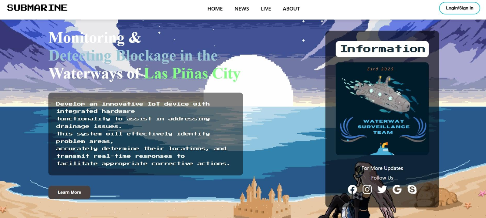
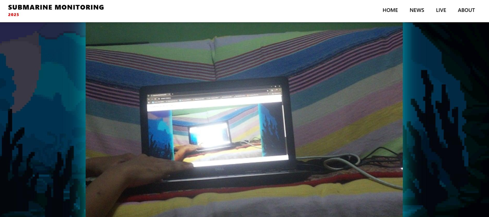
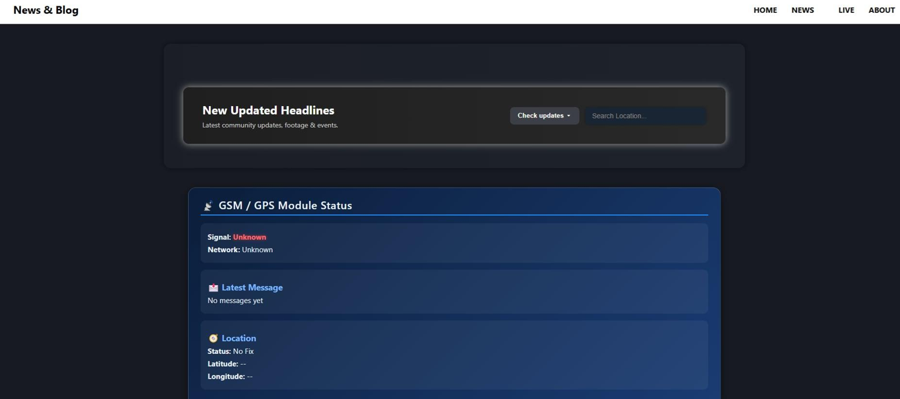

Demo Link: https://drive.google.com/drive/folders/1mGdQ2Kkp9u8D0lJuI0bGebLp2YUWQGYy?usp=sharing
# Development of Submarine for Monitoring and Detecting Blockage 
# in the Waterways of Las Piñas City

## Overview
An autonomous underwater submarine system designed to monitor 
and detect trash blockages in the waterways of Las Piñas City. 
The system uses a camera module paired with a YOLOv8 AI model 
to detect and classify waste objects in real time.

## My Role
This was a group capstone project with 4 members. I handled:
- Hardware assembly and integration
- Software development for hardware-software communication
- YOLOv8 AI detection implementation
- Thesis paper writing and documentation

## Tech Stack
- Raspberry Pi
- Python
- YOLOv8
- OpenCV
- Serial Communication

## Object Detection
The AI model was trained to detect trash-related objects, including:
- PET Bottles
- Plastic Bags
- Paper Bags
- Snack Wrappers

## Detection Results
Tested in a controlled environment. Results varied across materials:
| Material | Detection Rate |
|----------|---------------|
| PET Bottles | 67% |
| Snack Wrappers | 67% |
| Plastic Bags | 33% |
| Paper Bags | 33% |

> Results may vary depending on testing conditions, object 
> orientation, and training data availability.

## Project Website
As part of the capstone project, we developed a website to present the submarine system,
its objectives, and its YOLO-based waste detection capabilities

## Homepage

This section showcases information regarding the purpose of the submarine unit.

## Live Feed

This showcases the actual view of the camera feed to identify location of the blockage in sewage
and at the same time recording the footage and sending to the website, file broswer to set awareness,
or look upon what is happening in the scene.

## News & Blog

This displays the footage recording of the current situation. Shows real-time updating through the
website, file browser, and the raspberry pi.
## Status
Capstone defended and completed
